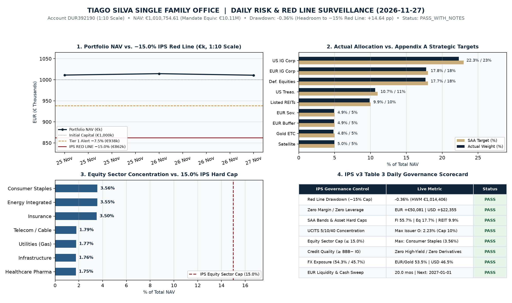

# Tiago Silva Single Family Office — Daily Risk & Red Line Surveillance

Automated daily portfolio surveillance engine (**Deliverable 4 / Appendix C**) monitoring the **€10,000,000** defensive Core-Satellite mandate executed on Interactive Brokers Paper Trading (`DUR392190`, scaled **1 : 10** = €1,000,000).

> **Disclaimer:** Personal & educational proof-of-work project in Private Wealth Management. The client, capital, and figures are fictional and illustrative; nothing herein constitutes financial, legal, or tax advice.

---

## Live Portfolio Telemetry (`2026-11-27` · `LIVE_API_YFINANCE`)

| Metric | Demo Account (`1:10`) | Mandate Equivalent (`€10M`) | IPS Benchmark / Rule |
| :--- | :---: | :---: | :--- |
| **Net Asset Value (NAV)** | **€1,010,754.61** | **€10,107,546.05** | Initial: €1,000,000 / €10,000,000 (`+1.08%`) |
| **High-Water Mark (HWM)** | €1,014,406.11 | €10,144,061.10 | Cash-flow adjusted peak |
| **Peak-to-Trough Drawdown** | **`-0.36%`** | **`-0.36%`** | **Red Line Cap: −15.0%** (Headroom: `+14.64 pp`) |
| **Cash Balances (Zero Margin)** | `EUR +€50,081.47` · `USD +$22,355.03` | `EUR +€500,815` · `USD +$223,550` | Status: **`PASS`** (Zero Leverage / Shorting) |
| **FX Exposure (`EUR/USD = 1.0983`)** | `EUR/Gold 53.5%` · `USD 46.5%` | `EUR/Gold 53.5%` · `USD 46.5%` | Target: `54.3% EUR/Gold` / `45.7% USD` |
| **EUR Liquidity Buffer (`IEGE`)** | €49,940.86 (`4.94%`) | €499,409 (`20.0 mos`) | Min: €500k (Alert ≤ €450k) · Next Sweep: `2027-01-01` |
| **UCITS 5/10/40 & Sector Cap** | Max Issuer `O` (`2.23%`) | Max Sector `Consumer Staples` (`3.56%`) | Caps: `10%` Single Issuer · `15%` Equity Sector |
| **Overall Governance Verdict** | **`PASS_WITH_NOTES`** | **`PASS_WITH_NOTES`** | Updated `2026-11-27T03:43:03Z` |



---

## How the Automation Works

* **Schedule:** Runs automatically via GitHub Actions (`.github/workflows/daily_monitor.yml`) every weekday at **21:30 UTC** (after NYSE/NASDAQ close) and can be triggered manually anytime under the **Actions** tab.
* **Independent Price Feeds:** Pulls closing prices across NYSE, NASDAQ, Euronext, Xetra, BME, LSE, SIX, and Borsa Italiana plus `EURUSD=X` via `yfinance`, with currency sanity checks and stale-price fallbacks.
* **Custodian Reconciliation (`src/ibkr_parser.py`):** Whenever a new IBKR Activity Statement CSV is exported, run:
  ```bash
  python src/sfo_risk_monitor.py --ibkr-csv data/DUR392190_YYYYMMDD.csv
  ```
  The parser automatically isolates `Segmento = DUR392190` (ignoring any bundled demo advisor sub-accounts), updates quantities & cash, and recalculates all IPS controls.

## Repository Structure

```text
├── .github/workflows/daily_monitor.yml   # Automated weekday surveillance (21:30 UTC)
├── config/portfolio_manifest.json        # 23 verified positions, ISINs, yields & IPS v3 rules
├── data/DUR392190_20261125_clean.csv     # Official Day 0 IBKR statement (isolated DUR392190)
├── src/ibkr_parser.py                    # Multi-account IBKR CSV cleaner & manifest sync
├── src/sfo_risk_monitor.py               # Core Red Line, UCITS, Margin & Cash Sweep engine
├── output/audit_log.csv                  # Daily historical track record (Excel-ready)
├── output/alerts_log.csv                 # Timestamped compliance alerts for Quarterly Report
├── output/latest_report.json             # Structured JSON snapshot (ready for Fact Sheet / LLM)
└── output/red_line_dashboard.png         # 4-panel institutional risk dashboard
```
